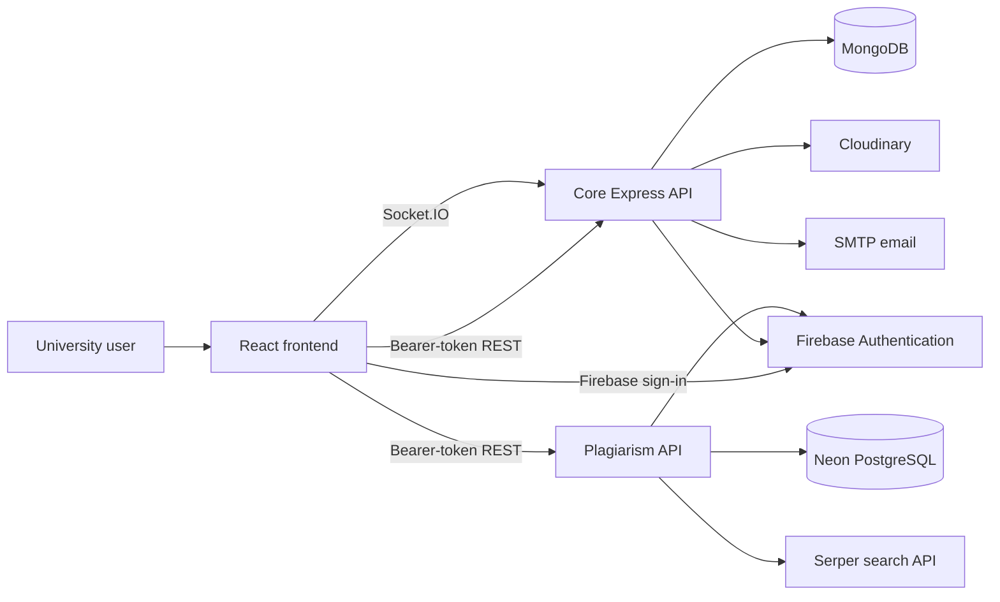

# UniDesk System Documentation

## Overview

UniDesk is a university learning-management platform composed of three independently deployable applications:

- `UniDesk_Backend` is the core REST API, real-time server, and primary business system.
- `UniDesk_Frontend` is the React single-page application used by students, faculty, and administrators.
- `UniDesk_Plagiarism` is a separate plagiarism-analysis microservice.

The platform supports three roles. Students join courses, submit work, view results, communicate with faculty, request appointments, use the academic repository, and run plagiarism checks. Faculty create and manage courses, upload learning resources, grade submissions, manage schedules and appointments, and supervise students. Administrators manage users, repository moderation, mentorship relationships, and system-wide views.

## Authentication and authorization

Firebase Authentication is the shared identity provider. The frontend supports email/password and Google login. After sign-in, it obtains a Firebase ID token, stores it as `access-token` in local storage, and sends it as a Bearer token to both API services.

The core API validates the token, loads the corresponding MongoDB user, verifies the requested role, and rejects users whose account status is `pending` or `suspended`. User records have one of these states:

- `pending`: an email/password account needs email verification.
- `verified`: the user may access role-protected features.
- `suspended`: access is blocked.

Registration validates KUET email formats. Student registration validates the roll number, department, and batch against the institutional email address. Faculty registration validates a departmental KUET address; Google-authenticated faculty are also checked against a `facultyInformations` collection.

## UniDesk_Backend

### Technology and structure

The backend uses Node.js ES modules, Express 5, MongoDB with Mongoose, Firebase Admin SDK, Socket.IO, Cloudinary, Nodemailer, and node-cron. `src/app.js` mounts all HTTP routes under `/api`. `src/index.js` connects MongoDB, starts the HTTP and Socket.IO servers, sets the default timezone to Asia/Dhaka, and loads scheduled jobs.

### Data model

The primary operational database is MongoDB.

| Domain | Main information |
|---|---|
| User | Name, KUET email, role, department, student/faculty metadata, profile image, contact/research details, and account status. |
| Course | Code, name, session, department, year, semester, invitation code, meeting link, faculty, students, and status. |
| Assignment and submission | Instructions, deadline, marks, attachments, one submission per student, grading, feedback, and recheck state. |
| Announcement and material | Course notices and learning resources, including Cloudinary file metadata. |
| Repository and leaderboard | Shared resources, moderation status, tags, downloads, contributor points, and per-user totals. |
| Schedule and appointment | Faculty classes/free slots, meeting requests, approval state, mode, online link, and cancellation data. |
| Conversation and message | Two-person conversations, messages, sender, timestamps, and read state. |
| Supervisor | Thesis/project relationships, topic, description, and completion status. |
| Notification | Recipient, sender, event type, related entity, target URL, and read status. |

Notable constraints include unique course invitation codes, one submission per assignment/student pair, one schedule per faculty member, and one supervisor document per faculty member.

### API responsibilities

All endpoints are prefixed with `/api`.

| Area | Main capabilities |
|---|---|
| Accounts | Registration, account status, email-verification completion, own-profile update, and administrator user management. |
| Courses | Faculty course creation/update, student or faculty joining by invitation, course membership, and enrolment management. |
| Course content | Faculty-controlled announcements, study materials, assignments, grading, and rechecks. |
| Appointments | Student booking, faculty approval/rejection/cancellation, and availability through weekly schedules. |
| Messaging | Conversation creation, message retrieval/sending, and message read-state updates. |
| Mentorship | Supervisor assignment, relationship status updates, removal, and batch supervisor contact. |
| Repository | Authenticated uploads, public listing/leaderboard access, and administrator moderation. |
| Notifications | Fetching notifications/unread counts and marking notifications read. |

### Files, notifications, and automation

The client uploads profile images and academic files directly to Cloudinary with configured upload presets, then sends the URL and public ID to the API. MongoDB stores file metadata rather than the file body.

Notifications are saved in MongoDB, emitted to a recipient-specific Socket.IO room, and retained to a maximum of 30 per user. Selected events also send email, including assignment updates, grades, appointment updates, reminders, repository approval, and supervisor contact.

A cron job runs every ten minutes. It sends assignment reminders for deadlines within 24 hours, meeting reminders for approved meetings within one hour, marks passed approved appointments complete, and rejects expired pending appointments.

### Real-time functionality

Socket.IO provides user-specific rooms, online/offline presence, a three-second disconnect grace period, typing indicators, and notification refresh signals. REST remains the source of truth for conversations, messages, and notifications.

## UniDesk_Frontend

### Technology and application structure

The frontend uses React 19, Vite, React Router, Tailwind CSS, DaisyUI, Material UI, Firebase Client SDK, Axios, Socket.IO Client, FullCalendar, Chart.js/Recharts, and Sonner notifications.

Authentication state is held centrally. The application listens for Firebase session changes, requests the current database account status, refreshes the stored token, and connects the socket only after it has the MongoDB user ID.

Role-aware route wrappers ensure users reach only the dashboard appropriate to their database role and account status.

### User-facing areas

Students receive an activity dashboard, course and invitation-code joining flow, assessments and rechecks, mentor/appointment tools, profile, notifications, chat, repository access, and plagiarism checking.

Faculty receive activity and profile views, course management, supervision management, appointment and schedule management, detailed course tooling for materials/announcements/assignments/grading, chat, repository access, notifications, and plagiarism checking.

Administrators receive an overview, user management, mentorship management, course/repository views, user and faculty detail screens, and notifications.

The client uses separate Axios instances for the core API and plagiarism API. This permits independent base URLs and deployments. It also uses a Socket.IO client for presence, typing, and notification updates.

## UniDesk_Plagiarism

### Purpose and API

The plagiarism service is an Express 5 microservice backed by Neon PostgreSQL. It exposes one Firebase-protected endpoint:

`POST /api/check`

The request is multipart form-data. It accepts up to five files under `files`, accepts an optional `storeInRepository` Boolean, and permits PDF, DOCX, and plain-text files. Each file is held in memory and is limited to 10 MB.

The response includes document-processing metadata, internal comparison results, repository-comparison results, web-source results, and file-processing errors.

### Detection process

1. Extract text from PDFs with `pdf-parse`, DOCX files with `mammoth`, and text files directly.
2. Split text into overlapping 50-word chunks with a 10-word overlap.
3. Compare uploaded files with one another.
4. Compare uploaded files with documents stored in PostgreSQL.
5. Search important text chunks online through Serper and compare matched pages.
6. Return scores, verdicts, shared terms, fingerprint overlap, hotspots, and failures.

Similarity combines two equally weighted measures:

- TF-IDF cosine similarity over one-word, two-word, and three-word terms.
- Winnowing-fingerprint Jaccard similarity using five-character grams and a window size of four.

Scores over `0.10` are returned as candidates. A score of at least `0.50` is medium risk; a score of at least `0.80` is high risk. Chunk comparisons identify up to five high-similarity hotspots.

For online checks, the service selects up to three information-rich chunks, asks Serper for results, removes duplicate URLs, fetches at most five pages per uploaded document, and performs the same similarity calculation. Delays are applied between search and page-fetch operations, so web-heavy checks can take longer.

### PostgreSQL corpus

The service expects externally provisioned `documents` and `document_chunks` tables. Documents hold the filename, full extracted text, and creation time. Chunks hold the parent document ID, order, and chunk text. No database migration file is present in the visible project, so this schema needs to be created during deployment.

## Required configuration

| Application | Required environment values |
|---|---|
| Core API | `MONGODB_URI`, base64-encoded `FB_SERVICE_KEY`, Cloudinary credentials, `LIVE_LINK`, and SMTP settings when email is enabled. `PORT` defaults to `3000`. |
| Frontend | Firebase `VITE_*` values, `VITE_SERVER_URL`, `VITE_PLAGIARISM_URL`, and Cloudinary cloud/upload-preset values. |
| Plagiarism API | `PORT`, `DATABASE_URL`, base64-encoded `FB_SERVICE_KEY`, and `SERPER_API_KEY`. |

All three services must use the same Firebase project so the client-issued ID token can be validated by both APIs.

## Local startup

Install packages independently in each project with `npm install`.

Start the core API with `npm run dev` inside `UniDesk_Backend`. Start the plagiarism API with `npm run dev` inside `UniDesk_Plagiarism`. Start the frontend with `npm run dev` inside `UniDesk_Frontend`.

MongoDB, PostgreSQL, Firebase, and Cloudinary need to be configured before normal application flows will work. The plagiarism database schema must also exist before the plagiarism API starts.

## Tests

The core API contains Jest/Supertest unit and integration coverage for controllers, routes, utility functions, and an in-memory MongoDB setup. Available commands are `npm test`, `npm run test:unit`, `npm run test:integration`, and `npm run test:ci`.

The frontend contains Jest tests for helpers, functions, and integration-oriented behavior. The plagiarism service contains unit tests for chunking/search-query utilities and an integration test for its check route. Run `npm test` in either of those projects to execute their configured tests.
